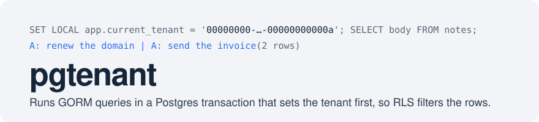
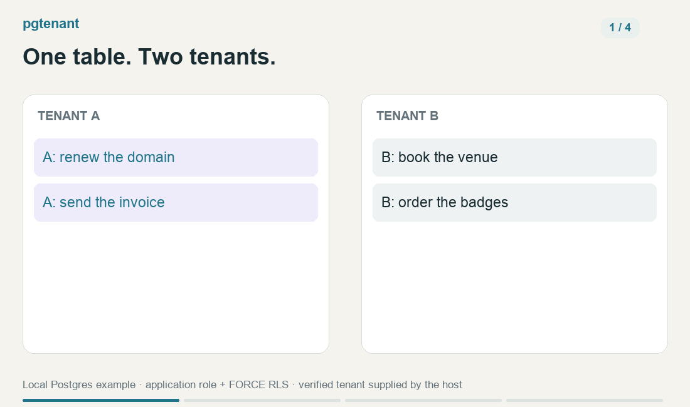
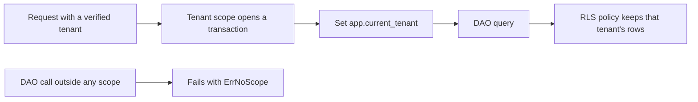

<picture>
  <source media="(prefers-color-scheme: dark)" srcset=".github/assets/banner-dark.svg">
  
</picture>

[](LICENSE)
[](go.mod)

A Go service that keeps tenants apart in one Postgres database with row-level security (RLS)
must set the tenant inside every transaction, and a code path that forgets gets no rows back,
with no error to say why. pgtenant sets the tenant once for a block of code, an HTTP request or
a gRPC call, so your GORM DAO methods take no tenant argument.



One query, different tenant rows; an unscoped DAO call fails visibly. [Demo details](.github/assets/demo/README.md).

## How it works

<details>
<summary>Implementation flow</summary>



Your authentication verifies the caller's tenant, which pgtenant calls an org ID. A tenant scope
is one transaction for that org, with `app.current_tenant` set before your first query. Your RLS
policy reads that setting, so it filters what the query reads and checks what it writes. A DAO
call through `tenantdb.DB` outside any scope fails with `ErrNoScope` instead of quietly
returning no rows.


</details>

## Quick start

You need Go 1.26 or later, and Docker Compose or podman-compose for a local Postgres 17.

1. Clone the repository.

   ```sh
   git clone https://github.com/tetriz-ai/pgtenant && cd pgtenant
   ```

2. Start Postgres on `127.0.0.1:5433`.

   ```sh
   docker compose up -d   # or: podman-compose up -d
   ```

3. Run the demo. Its table holds notes for tenants A and B, and it reads them in tenant A's scope.

   ```sh
   go run ./examples/read-own-rows
   ```

   ```text
   A: renew the domain | A: send the invoice
   ```

Only tenant A's two notes come back. The demo,
[`examples/read-own-rows/main.go`](examples/read-own-rows/main.go), runs this query in tenant
A's scope. `demo.Setup` creates the table, its policy and an application role, then connects as
that role.

```go
	err = tenantdb.TenantTx(ctx, db, demo.TenantA, func(tx *gorm.DB) error {
		var bodies []string
		if err := tx.Raw("SELECT body FROM notes ORDER BY body").Scan(&bodies).Error; err != nil {
			return err
		}
		fmt.Println(strings.Join(bodies, " | "))
		return nil
	})
```

If port 5433 is taken, or to stop Postgres, see [docs/install.md](docs/install.md).

## What's in the box

| Package | Use it to |
|---|---|
| [`tenantdb`](https://pkg.go.dev/github.com/tetriz-ai/pgtenant/tenantdb) | Run a block, or a chain of DAO calls, in one tenant's scope or across all |
| [`grpctenant`](https://pkg.go.dev/github.com/tetriz-ai/pgtenant/grpctenant) | Open each gRPC call's scope from a `tenant_scope` option on the RPC |
| [`testdb`](https://pkg.go.dev/github.com/tetriz-ai/pgtenant/testdb) | Give each test a fresh database built from your schema dump, policies included |
| [`gormctx`](https://pkg.go.dev/github.com/tetriz-ai/pgtenant/gormctx) | Let DAO methods join a transaction you already hold |

What it does not do:

- It does not write or check your policies, so a loose one lets rows through.
- It does not authenticate callers. It takes the org ID your code verified.
- It does not run your migrations. `testdb` loads a schema dump you commit.

## Common tasks

### Add pgtenant to your module

Fetch `tenantdb`, then supply the policy, role and Postgres that [docs/install.md](docs/install.md)
lists.

```sh
go get github.com/tetriz-ai/pgtenant/tenantdb@latest
```

### Scope DAO methods

`RunInScope` and `RunInScopeValue` put a tenant in the context for DAO methods that query through
`tenantdb.DB(ctx, db)`, as [dao-scope](examples/dao-scope/main.go) shows. The plain `*gorm.DB`
sets no tenant and gets no rows.

```go
// countNotes is a DAO method. It takes no tenant, because the scope in ctx picks one.
func countNotes(ctx context.Context, db *gorm.DB) (int64, error) {
	var n int64
	err := tenantdb.DB(ctx, db).Raw("SELECT count(*) FROM notes").Scan(&n).Error
	return n, err
}

	n, err := tenantdb.RunInScopeValue(ctx, demo.TenantB, tenantdb.ScopeEnforced,
		func(ctx context.Context) (int64, error) { return countNotes(ctx, db) })
	fmt.Println("in tenant B's scope:", n, err)
	_, err = countNotes(ctx, db)
	fmt.Println("outside any scope:", err)
```

`go run ./examples/dao-scope` prints:

```text
in tenant B's scope: 2 <nil>
outside any scope: tenantdb: no scope in context
```

### Scope each gRPC call

Annotate each RPC with the `tenant_scope` option and chain the `grpctenant` interceptor after
your authentication, as [grpc-service](examples/grpc-service/) does. An RPC without the option
is not intercepted, so its DAO calls fail with `ErrNoScope`.

```proto
  rpc ListNotes(ListNotesRequest) returns (ListNotesResponse) {
    option (pgtenant.v1.tenant_scope) = TENANT_SCOPE_ENFORCED;
  }
```

```sh
go run ./examples/grpc-service
```

```text
ListNotes as tenant A: [A: renew the domain] [A: send the invoice]
ListNotes without a token: Unauthenticated
ListNotes with only a client-sent org_id: Unauthenticated
ListNotes as tenant A, also sending tenant B's org_id: [A: renew the domain] [A: send the invoice]
ListNotes as tenant B: [B: book the venue] [B: order the badges] [B: print the programme]
AddNote without a token, naming tenant A in the request: Unauthenticated
CountAllNotes as tenant A: PermissionDenied
CountAllNotes in system scope: 5
```

### Prove tenants stay apart

[isolation-test](examples/isolation-test/) is a test to copy. It loads the committed dump in
`testdata/schema.sql` with `testdb` and checks that tenant A can neither read nor write tenant B's rows.
`PGTENANT_REQUIRE_TEST_DB=1` makes it fail instead of skip when Postgres is down.

```sh
PGTENANT_REQUIRE_TEST_DB=1 go test -count=1 ./examples/isolation-test/
```

```text
ok  	github.com/tetriz-ai/pgtenant/examples/isolation-test	0.629s
```

## Limitations

- Force RLS on each table your login role owns, or its owner sees every tenant.
- `TrustIncomingMetadata` and `TrustRequestOrgID` let the caller pick its tenant, so enable them
  only for trusted callers.
- Run `SystemTx`, the all-tenants scope, as your application role, because it does not refuse a
  superuser or `BYPASSRLS` role.
- Give each goroutine its own scope, since two querying at once in one scope get `ErrScopeBusy`.
- CI runs Postgres 17 only. Test other versions yourself.

[docs/limitations.md](docs/limitations.md) has the full list and what to do about each.

## More

- [docs/reference.md](docs/reference.md): the policy, the settings pgtenant writes, interceptor and test options
- [docs/usage.md](docs/usage.md): which entry point fits your code, and how to wire it
- [docs/install.md](docs/install.md): what your service supplies, and running the local Postgres
- [examples/](examples/): six runnable examples, which CI runs
- [CONTRIBUTING.md](CONTRIBUTING.md#run-the-checks): the test suite and the checks CI runs
- [SECURITY.md](SECURITY.md): how to report a vulnerability privately
- [LICENSE](LICENSE): MIT, with third-party material listed in [NOTICE](NOTICE)

pgtenant follows semantic versioning. Before v1.0 a minor release may change an exported API,
the settings pgtenant writes or the `tenant_scope` proto option, and [CHANGELOG.md](CHANGELOG.md)
says so. CI tests Go 1.26 and 1.27.

Copyright 2026 Workloom Solutions Private Limited. Contributors are listed in
[CONTRIBUTORS.md](CONTRIBUTORS.md).
